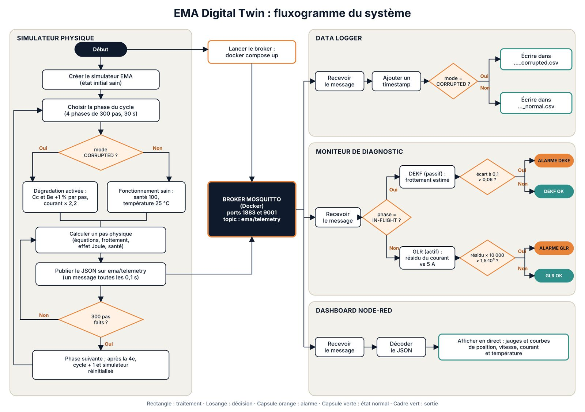

# EMA Digital Twin & Health Monitoring System
**Authors:** Maria Eduarda Nascimento Andrade & Meryem Hamamouch

     

## Overview
This repository contains a real-time simulation and monitoring system for Electromechanical Actuators (EMAs), structured around an MQTT messaging architecture. The application's core consists of a physical simulator (`physical-EMA-simulator.py`) that models the actuator's dynamic, thermal, and degradation behaviors, publishing continuous telemetry metrics to a local broker.

Complementing the system, a logging script (`data-logger.py`) automatically captures and stores this data in a structured CSV file for subsequent analysis, while a diagnostic monitor (`diagnostic-monitor.py`) analyzes the telemetry stream both passively and actively. Together, these tools simulate failure scenarios and provide early detection of operational anomalies based on statistical thresholds and friction deviations.

## Real-Time Visualization & Monitoring (Node-RED)
To provide immediate insights into the system's behavior, a **Node-RED dashboard** is integrated into the architecture. It subscribes to the MQTT broker to parse the live telemetry JSON payloads and visualize the data in real-time. The graphical interface features responsive gauges and time-series charts, allowing users to actively monitor critical physical parameters—such as position, velocity, electrical current, and temperature. This visualization layer ensures immediate feedback on the EMA's operational state and makes the impact of mechanical degradation visually apparent as the simulation unfolds.

## System Architecture & Execution Flowchart
The overall architecture and data flow of the digital twin are illustrated in the flowchart below, which details the interaction between the physical simulation engine, the message broker, and the downstream processing services[cite: 1]:

  

The execution pipeline operates across five coordinated modules[cite: 1]:

1. **Infrastructure Initialization & MQTT Broker:** Execution begins with the deployment of the containerized **Mosquitto MQTT Broker** via Docker (`docker compose up`), exposing ports `1883` and `9001` to handle telemetry distribution on the `ema/telemetry` topic[cite: 1].
2. **Physical Simulator (`physical-EMA-simulator.py`):** The simulator initializes the EMA in a nominal healthy state (100% health, 25 °C) and iterates through operational cycles consisting of 4 distinct phases of 300 steps each (30 seconds per phase)[cite: 1]. Depending on the selected operating mode (`NORMAL` vs. `CORRUPTED`), the simulation either maintains nominal parameters or injects progressive mechanical degradation—increasing Coulomb ($C_c$) and viscous ($B_e$) friction coefficients by 1% per step alongside a $2.2\times$ current multiplier[cite: 1]. At each 0.1 s time step, physical equations (dynamics, friction, and Joule heating) are solved, and the resulting state is published as a JSON payload to `ema/telemetry`[cite: 1]. Upon completing all 4 phases, the cycle counter increments and the simulator resets[cite: 1].
3. **Data Logger (`data-logger.py`):** Subscribed to the telemetry stream, this service appends a timestamp to each incoming payload and routes the record to either `..._normal.csv` or `..._corrupted.csv` according to the active simulation mode[cite: 1].
4. **Diagnostic Monitor (`diagnostic-monitor.py`):** Incoming telemetry is evaluated through a phase-dependent fault detection strategy[cite: 1]:
   * **Passive Monitoring (In-Flight Phase):** Employs a Dual Extended Kalman Filter (DEKF) to estimate friction torque, triggering a `DEKF ALARM` if the deviation from the nominal value ($0.1$) exceeds $0.06$[cite: 1].
   * **Active Monitoring (Non-In-Flight Phases):** Applies the Generalized Likelihood Ratio (GLR) algorithm to evaluate current residuals against a $5\text{ A}$ reference, raising a `GLR ALARM` when the scaled residual ($\times 10\,000$) surpasses $1.5 \times 10^5$[cite: 1].
5. **Real-Time Visualization (Node-RED Dashboard):** Concurrently consumes the `ema/telemetry` topic, decodes the JSON structure, and updates live gauges and time-series plots for position, velocity, current, and temperature[cite: 1].

## Acknowledgments & Inspiration
The mathematical models and diagnostic algorithms implemented in this project are heavily inspired by the methodologies presented in the thesis by B. Wauthion. Specifically, this project adapts advanced concepts from the research, including the EMA friction torque models, the use of the Dual Extended Kalman Filter (DEKF) for passive in-flight fault detection, and the application of the Generalized Likelihood Ratio (GLR) algorithm for active fault detection.